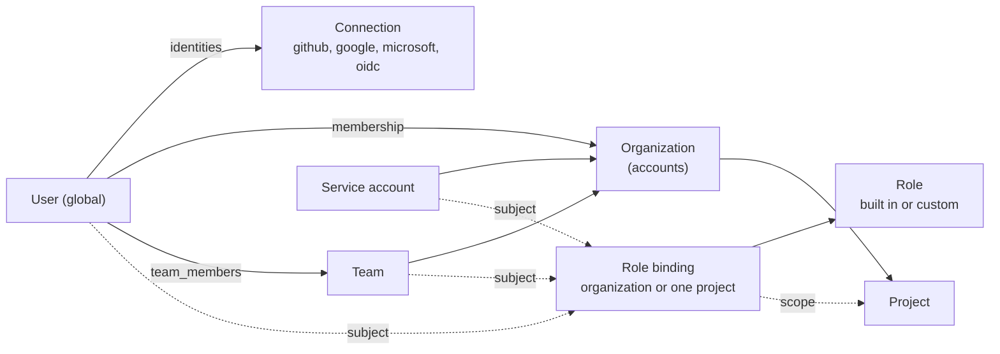

# Identity and access

Who can use Forecrew and how they prove it: organizations, people, teams,
service accounts, sign-in connections, sessions and tokens (plan decisions
25–27). The tables are in [data-model.md](data-model.md) (migration 00005),
the types in `internal/domain` (`identity.go`, `permission.go`, `actor.go`),
the repositories in `internal/store` and the permissions and roles in
[permissions.md](permissions.md). Configuration is `auth` in
[config.md](config.md).

Built in order: this contract (T51), sign-in and sessions (T52), the
authorization engine (T53), the organization UI and `forecrew login` (T54),
OAuth for MCP clients (T55) and the enterprise features (T56). Each builds on
this file without changing it; a task that needs a change stops and says so.

## Model

- **Organization.** The existing `accounts` table is the organization:
  storage, Go types, repositories and JSON field names keep
  `account`/`account_id` (api.md); the UI, CLI output and docs say
  organization. An organization has a unique `slug`
  (`domain.ValidSlug`: 1–63 lowercase letters, digits and `-`, starting and
  ending with a letter or digit; derived from the name with the first free
  `-2`, `-3`, and so on unless one is given, and a given one that is taken
  is a conflict) used in URLs (`/login?org=<slug>`,
  `/scim/v2/<slug>/`), `created_by` (an actor; empty for the organization
  created at install) and `max_token_ttl` (see Tokens). Everything project-scoped stays scoped by
  `account_id`.
- **User.** A person, global across organizations: name, primary email,
  `email_verified`, `instance_admin`, `disabled_at`, `last_seen_at`. A
  verified email belongs to one user (ignoring case). A disabled user cannot
  sign in, and their sessions, tokens and OAuth grants stop working.
- **Identity.** A user's account at an identity provider, through a
  connection: the provider's stable `subject` (OIDC `sub`, the GitHub user
  ID, never the login), plus the `login` (GitHub login) and `email` the
  provider reported at the last sign-in. `(connection, subject)` is unique.
  Only these identity claims are kept; provider access, refresh and ID tokens
  are never stored.
- **Membership.** A user in an organization: status `active`, `invited` or
  `suspended`, source `manual`, `invitation`, `jit` or `scim`, and the SCIM
  `externalId`. Only active members get permissions. One per organization
  and user. Removing a member deletes, in one transaction, their team
  memberships, their role bindings in the organization and the membership.
  Their sessions, personal tokens and OAuth grants in the organization end
  in the same transaction: the store's suspend and remove revoke the OAuth
  grants themselves, so no path forgets them and reinstating the member
  brings none back; sessions and tokens are separate calls inside
  `Store.WithTx`.
- **Invitation.** An email or a GitHub login (exactly one; a login is
  resolved to its stable GitHub user ID at creation, and acceptance compares the
  ID, because a login can be renamed and then taken), the roles to
  grant on acceptance (`domain.Grant`: a role on the organization or one
  project), an expiry, `invited_by` and, once accepted, `accepted_by` and
  `accepted_at`. Its link carries a random token; only the SHA-256 is
  stored. Accepting it creates the membership (source `invitation`) and the
  bindings.
- **Team.** A named group of members of one organization (`slug` unique per
  organization), source `manual`, `idp` (group mapping) or `scim`, with the
  SCIM `externalId`. Team members must be members of the team's
  organization; each member has its own source, so group mapping and SCIM
  only add and remove the members they manage and never touch manual ones.
- **Service account.** A non-human member for CI and scripts: name (a
  `domain.ValidName`, unique per organization), description, `created_by`,
  `disabled_at`. It holds tokens and role bindings like a user and never
  signs in interactively.
- **Agents are not users.** Their limits stay in role packs, pools and job
  tokens ([job-mcp.md](job-mcp.md)), and they never resolve gates.

## Roles, bindings and the last Owner

Permissions, built-in roles and the rules for evaluating them are in
[permissions.md](permissions.md). A role binding gives a role to a subject
(`user`, `team` or `service_account`) on the organization (`project_id`
NULL) or on one project. Effective permissions are the union of the
bindings that apply; there are no deny rules.

The store enforces in the database (migration 00005 triggers), whichever
code path makes the change:

- a binding's role is built in or a custom role of the same organization;
  an organization role is never bound to a project; the subject is a member,
  team or service account of the organization; the project is the
  organization's;
- the built-in Owner role is bound to users only, on the organization;
- **an organization that has an active Owner always keeps one.** An active
  Owner is a user bound to the built-in Owner role on the organization, with
  an active membership, not disabled. Deleting or changing their binding,
  suspending or deleting their membership, or disabling the user fails with
  `store.ErrLastOwner` (constraint `last_owner`) when no other active Owner
  is left. Concurrent changes are checked one after the other (the
  organization row is locked). An organization without any Owner (as right
  after migration 00005) is not guarded until it gets its first;
- built-in roles change only by migration.

## Connections

A connection is a way to sign in: kind `github`, `google`, `microsoft` or
`oidc`, a name (`domain.ValidName`), the `issuer` (an `https` URL for `oidc`
and `microsoft`, empty or `https://accounts.google.com` for `google`, empty
for `github`), the `client_id`, the client secret **by reference**, `jit`
`{enabled, default_roles}`, `group_claim` and `enabled`.

- Forecrew is an OpenID Connect relying party only and never parses SAML.
  `github` is the Forecrew GitHub App's user authorization; the others use
  OIDC discovery, authorization code with PKCE, `state` and `nonce`.
- **Secrets are never stored.** `client_secret_ref` is `env:NAME` (an
  environment variable of forecrewd, uppercase letters, digits and `_`) or
  `secret:name` (the file `/run/secrets/<name>`, Docker's and Kubernetes'
  secret mount; lowercase letters, digits, `.`, `_`, `-`, `/`, no `..`).
  `domain.ValidSecretRef`, `domain.Connection.Validate` and a CHECK refuse
  anything else, a secret value in particular. forecrewd reads the value
  when it needs it, keeps it in memory only and never logs it.
- **An organization's connection reaches a reserved namespace only:**
  `env:FORECREW_CONN_*` or `secret:conn-*`
  (`domain.ValidOrganizationSecretRef`). Whoever manages the connection
  controls its `issuer`, and forecrewd sends the client secret there, so any
  other reference would let them read forecrewd's own secrets, the database
  URL for one. Instance connections, written by the operator, keep the full
  forms. Every organization can name every reference in the namespace, so
  the operator puts only connection secrets there, and an instance whose
  organizations do not trust each other waits for the secret store.
- **The secret store** adds a third form, `store:name`, which resolves in
  the connection's own organization (at instance level for an instance
  connection), so it is allowed on every connection: it reaches no other
  organization's values and none of forecrewd's own. Names starting `staged/`
  are reserved and refused. See
  [config-resources.md](config-resources.md), Secrets.
- **Instance-level connections** come from `auth.connections` in
  forecrew.yaml and are usable by every organization (for example the GitHub
  App and a company-wide Google). forecrewd upserts them at startup by name
  as rows with `account_id` NULL, so identities and sessions reference every
  connection the same way. They have no JIT. An organization's own
  connections are rows with its `account_id`; names are unique per
  organization and among instance connections. Sign-in routes name a
  connection by ID.
- `group_mappings` map an external group of a connection (from
  `group_claim`) to a team of an organization (enterprise). The connection
  is instance-level or the organization's own; the database refuses others.
  Who may add one is in permissions.md, No escalation.
- **Linking by email.** A sign-in links a new identity to an existing user by
  verified email only through an instance connection, or through an
  organization's connection for an email in a domain that organization
  verified. Otherwise the person who manages the connection could claim
  anyone's email at their own `issuer` and become that user in every
  organization.
- `verified_domains` (enterprise): an email domain, the DNS TXT
  `verification_token` (public, not a secret), `verified_at`, `enforce_sso`
  and the enforced `connection`. A domain may be pending in several
  organizations but verified in one; `enforce_sso` needs it verified and a
  connection.

## Sessions

A browser session is server-side: the `forecrew_session` cookie holds a
random token (prefix `fcs_`), the `sessions` row its SHA-256, the user, the
current organization (NULL until one is picked), the connection used (NULL
for a break-glass sign-in), `created_at`, `last_seen_at`, the idle expiry
(moved forward on use up to the absolute expiry), the absolute expiry, user
agent, IP and `revoked_at`. `auth.session_idle` and `auth.session_absolute`
set the two expiries. A suspended membership or a disabled user ends the
sessions concerned.

## Tokens

The existing `mcp_tokens` become **personal and service account tokens**,
for `/mcp` and `/api/v1`: `owner_kind` (`user` | `service_account`) and
`owner_id`, the organization (`account_id`), `scopes` (`read`, `write`,
`admin`; permissions.md, Scopes) and `expires_at` (default
`auth.token_default_ttl`). Names are unique per organization and owner.
The owner must be a member or service account of the organization when it is
set; the database refuses others. Values keep the `fcm_` prefix; only the SHA-256 is stored and the value is
shown once. A request with a token is limited to the intersection of its
scopes and its owner's current permissions in its organization, so a token
never outlives a role change.

Under SSO enforcement (enterprise, T56), the personal tokens of users whose
email is in an enforced domain are limited to the organization's
`max_token_ttl` (`domain.Account.MaxTokenTTL`; NULL is no cap). Turning
`enforce_sso` on sets it to 7 days (`domain.DefaultSSOTokenTTL`) when it is
NULL, and an Owner may allow longer (`org.manage`). The limit applies when a
token is created and when it is used (`created_at + max_token_ttl`), so
tokens older than the enforcement are limited too. Service account tokens and
organizations without enforcement are not affected.

Tokens from before migration 00005 keep working: they have no owner, scope
`admin` and no expiry until T52 assigns them to the first Owner of their
organization (`store.PersonalTokenRepo.AssignOwner`). A token whose name that
Owner already uses takes the first free `-2`, `-3`, and so on. Nothing is
deleted.

**An ownerless token is limited only by its scopes** (`admin` on those rows)
and acts as `mcp:<name>` (permissions.md, Scopes). Until T52 lands, `forecrew
token create` on the server makes such tokens too; from T52 on it must set an
owner, so no new ownerless tokens appear.

## OAuth for MCP clients

forecrewd is the authorization server of its own `/mcp` (T55). OAuth
clients are instance-wide (`oauth_clients`: public `client_id`, which may be
a client ID metadata document URL, name, redirect URIs, the SHA-256 of a
confidential client's secret). Every authorization code, access token and
refresh token is an `oauth_grants` row: its kind, its SHA-256, the user, one
organization, scopes, the resource (forecrewd's `/mcp` URL), the redirect URI
and PKCE challenge of a code, expiry, `used_at` (codes and refresh tokens are
single use) and `revoked_at`. All credentials of one authorization share a
`family_id`: reusing a used code or refresh token revokes the family, and
the family is the "connected app" users see and revoke. Suspension or
removal from the organization revokes the user's grants there.

## SCIM

`scim_tokens` (enterprise) are the bearer tokens of an organization's SCIM
endpoint: name, SHA-256, `created_by`, `last_used_at`, `revoked_at`. SCIM
users map to users with a membership whose `external_id` is the SCIM
`externalId` and source `scim`; SCIM groups map to teams with source `scim`
and their `external_id`. Forecrew keeps `userName` as the email, `name`,
`active` (the membership status) and `externalId`, and for groups
`displayName`, `externalId` and members. A SCIM token acts only on members
and teams with source `scim`, so it never reaches a member it did not
provision; creating one is limited by permissions.md, No escalation.
SCIM lets back in (`active: true`) only a membership it suspended itself
(`scim_suspended`, migration 00015); one an Owner suspended stays suspended
whatever the provider sends, and every other change of status clears the mark.

## Actors and the audit log

`domain.Actor` gains two kinds, whose name is the ID:

| Actor | Who |
|-------|-----|
| `user:<user id>` | a person, through a session, a personal token or an OAuth grant |
| `service_account:<id>` | a service account, through its token |

The credential the request used is recorded with the actor in
`audit_log.credential` as `session:<id>`, `token:<id>` or
`oauth_grant:<id>` (`domain.Credential`), never the secret. The other kinds
stay: `github:<login>`, `worker:<name>`, `system:<name>`, and `mcp:<token
name>` for ownerless tokens. Entries from before migration 00005 (`mcp:<name>`,
and `user:<operator>` from the server CLI) stay readable
(`domain.ParseActor`).

## Token prefixes

All tokens are 32 random bytes, base64url without padding, stored as
SHA-256 only (conventions.md, IDs and refs):

| Prefix | Token |
|--------|-------|
| `fcm_` | personal and service account tokens (and legacy MCP tokens) |
| `fcs_` | session cookie |
| `fci_` | invitation link |
| `fcu_` | setup link of a server's first Owner (Recovery) |
| `fco_` | OAuth authorization code, `fca_` access token, `fcr_` refresh token |
| `fcscim_` | SCIM token |

## Recovery

`auth.instance_admins` (verified emails or `github:<user ID>`, never a
login, which can be renamed and then taken by someone else) are people who
may open any organization's settings to recover access when its identity
provider is down; their `instance_admin` flag follows config at sign-in. A
server-side break-glass CLI (T52: `forecrew user add`, `forecrew org create`,
`forecrew user disable`, `forecrew session revoke`; T67: `forecrew setup-link`)
works on the database directly. Every such use is audited.

**Setup link.** `forecrew setup-link [--org default] [--ttl 1h]` prints a link
that makes the first Owner of an organization, in place of the first
`forecrew user add`. It works once, lasts at most 24 hours (1 hour by default)
and is stored as its SHA-256 only (`setup_links`). The token is in the URL
fragment (`/setup-link#fcu_...`), so no server log or Referer sees it; the setup
page posts it to `POST /auth/setup`, which answers the organization's name
and keeps the token in the short-lived `fc_setup` cookie until the sign-in.
Whoever then signs in through an instance connection becomes the first Owner of
that organization (the email is verified only when the provider proves it), and
the link is spent in the same transaction; an organization's own connection never
opens another organization's link. A link only ever makes the first Owner: the
CLI refuses to create one for an organization that has an Owner or an active
member, and the sign-in locks the organization's row and checks again, so a
second link, an invitation or `forecrew user add` that got there first leaves the
link refused (`setup_link_invalid`) and nothing changed, and a member who signs
in with a link's cookie is not promoted. Joining an organization takes the same
lock, one join at a time. The token is never logged, and the audit
log holds the link's ID (`setup_link.created`, `setup_link.used`), not the
token. `POST /auth/setup` takes only `application/json` (`415` otherwise), so a
form of another site cannot plant the cookie. Later Owners come in by invitation.

## Open core and enterprise

Open core: organizations, members, invitations, teams, service accounts,
built-in roles and project roles, GitHub, Google, Microsoft and generic OIDC
sign-in, sessions, personal tokens, OAuth for MCP and the audit log.
Enterprise (`ee/`, build tag `enterprise`, T56): verified domains and SSO
enforcement, JIT membership, group mapping, SCIM and custom roles. The
tables are the same in both builds; the open-core build never writes the
enterprise ones.

## Job tokens

The job MCP gateway at `/job-mcp` ([job-mcp.md](job-mcp.md)) is outside this
model: a job token (`fcj_`) belongs to one lease, not to a person, carries no
permissions from the catalog and is limited by the role's `tools` and the
lease. Human tokens, sessions and OAuth grants are refused there, and job
tokens are refused on `/mcp` and `/api/v1`.
